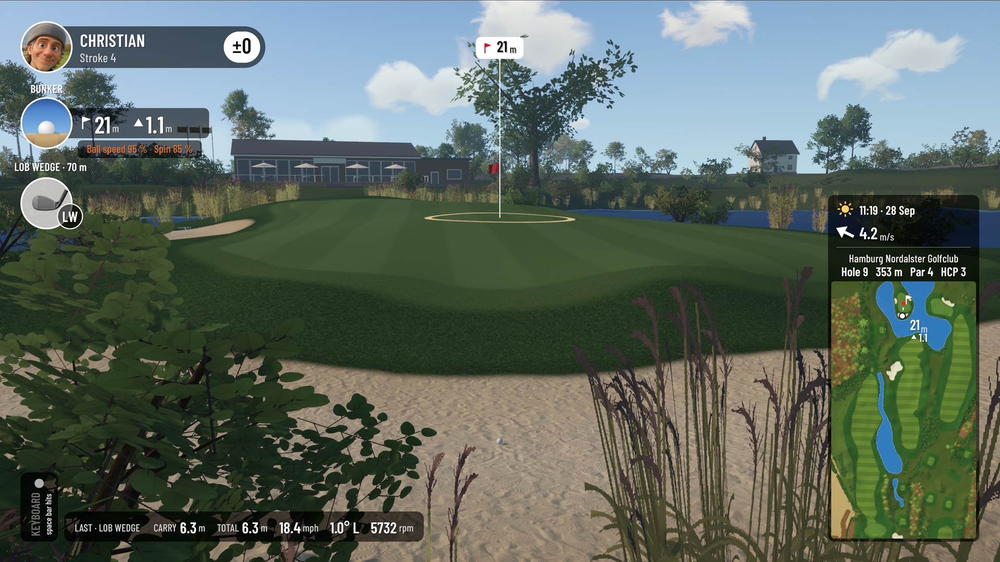
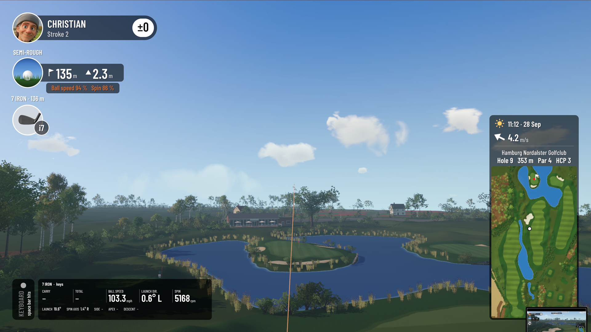
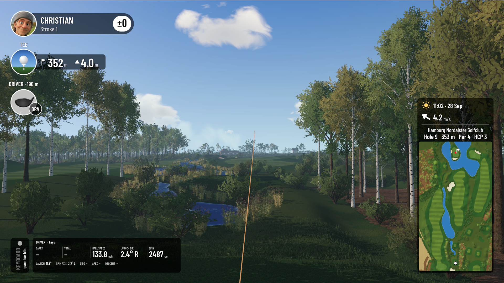
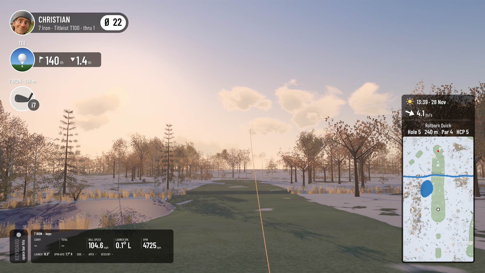
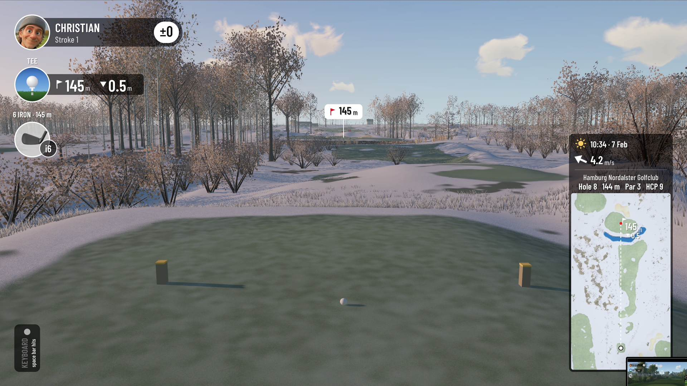
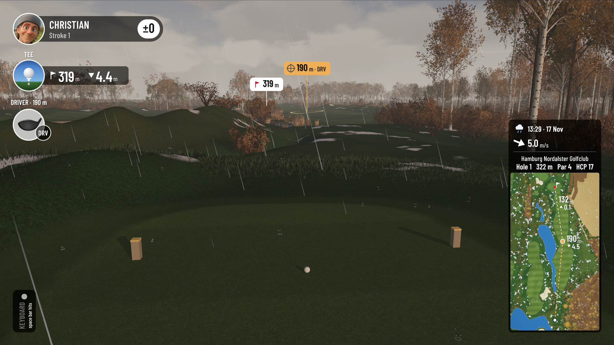
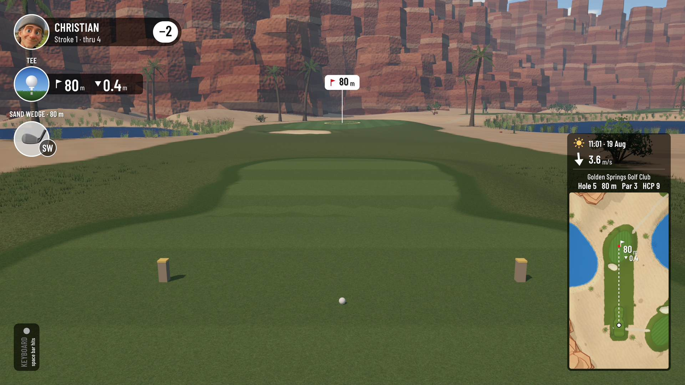
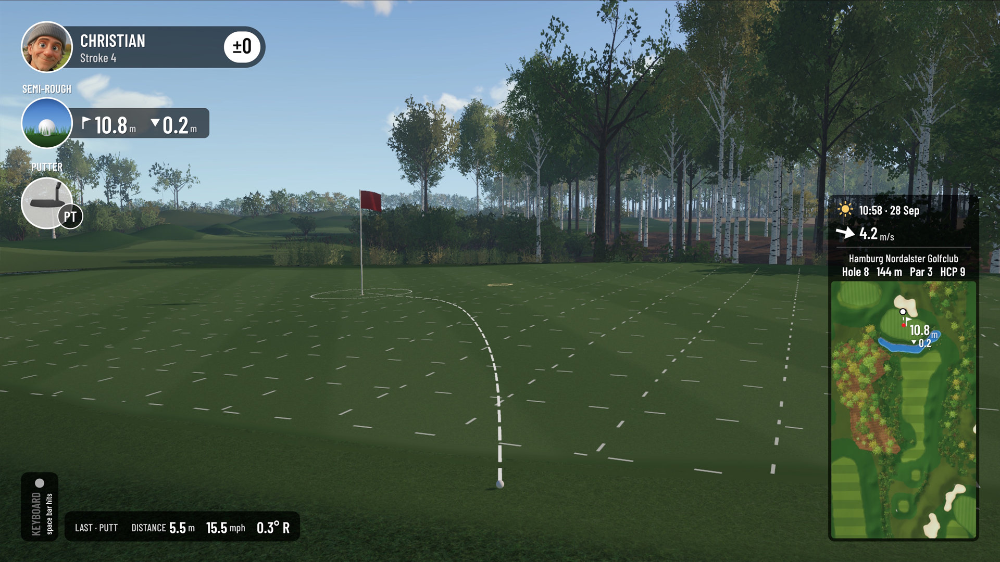
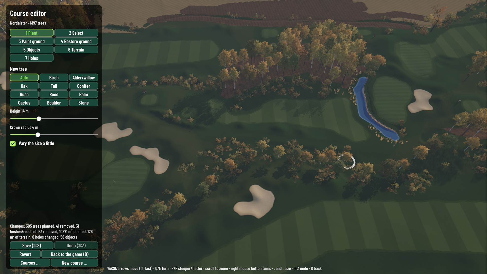

# Ludo Golf Simulator

*A golf simulator made for the Mac, also running on Windows.*

> **Status:** private beta, version 0.9.3 (November 2026). The source code is not public. Whether and under which license it will be opened has not been decided yet. This page shows what the simulator can do.

## Highlights

- **At home on the Mac.** A native app for Apple Silicon and Intel Macs, and a Windows version. Resolution up to 4K, 60 or 30 frames per second.
- **A realistic look.** Trees built by our own generator, with real branches and drawn leaf clusters: birch, alder, oak, conifer, palm and cactus. Reeds by the water, grass blades near the camera, haze in the distance. Trees change their level of detail smoothly instead of popping.
- **Seasons.** Leaves turn and fall one by one in autumn, hoarfrost covers the twigs in winter, fresh green comes back in spring.
- **Light and weather.** The sun stands right for the place, the month and the time of day, from dawn to dusk. Clouds, rain with wet ground and rings on the water, and gusty wind that moves the grass, the trees, the flag and the ball.
- **Ball physics.** Drag and lift from ball speed and spin, spin decay, air density, wind; bounce and roll for every surface and slope; trees that catch the ball. Checked against published launch monitor averages.
- **A course generator.** Roll a new course in seconds: 1 to 18 holes, par and length for each, parkland, mountains, desert or coast, little or much water, the kinds of trees. With a scorecard, stroke index and an estimated course rating and slope.
- **A course editor.** Plant trees, bushes, reeds, cacti and rocks, paint the ground, raise and flatten terrain, move tees, doglegs and pins, and place houses and a clubhouse in several colours.
- **Ways to play.** Stroke play, Stableford, target games, short game practice and nearest to the pin. A TV-style camera with tracer, shot data after every shot, a mini map, and rounds you can finish later.
- **Keyboard or launch monitor.** Play with the keyboard out of the box. Launch monitor support is in private testing.

## Pictures

<table>
<tr><td> An approach with tracer and shot data</td>
<td> Teeing off in summer</td></tr>
<tr><td> Late autumn on a generated course</td>
<td> Hoarfrost in February</td></tr>
<tr><td> Rain in November</td>
<td> A desert canyon</td></tr>
<tr><td> Putting: the line already aimed, the grid's dashes running downhill</td>
<td> The course editor</td></tr>
</table>

## Requirements

- macOS on Apple Silicon or Intel, or Windows 10/11 (64 bit).
- On a MacBook Air (M3) the realistic look runs well above 60 frames per second at 1920 × 1080.

## What's next

Being considered, not promised: open interfaces for launch monitor connectors, and course export and import, so courses can be shared or designed with other tools.

## Get in touch

Interested in testing, or in connecting a launch monitor? Open an issue in this repository.

## Thanks

Built with Unity. Ground and bark photos from ambientCG and Poly Haven (CC0), typeface Barlow Condensed (SIL Open Font License), cup sound from Freesound (CC0).

Map data © OpenStreetMap contributors (ODbL 1.0). Terrain and trees © GeoBasis-DE/LVermGeo SH, CC BY 4.0 (source modified).

## Auf Deutsch

Ludo Golf Simulator ist ein Golfsimulator für den Mac und für Windows, zurzeit in einer privaten Testphase. Der Quellcode ist nicht öffentlich; ob und unter welcher Lizenz er geöffnet wird, ist noch nicht entschieden.

---

© 2026 Christian Weikert. All rights reserved. Pictures and text may not be reused without permission.
